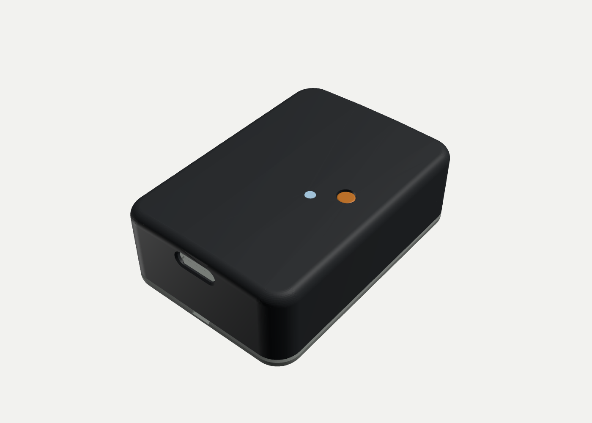
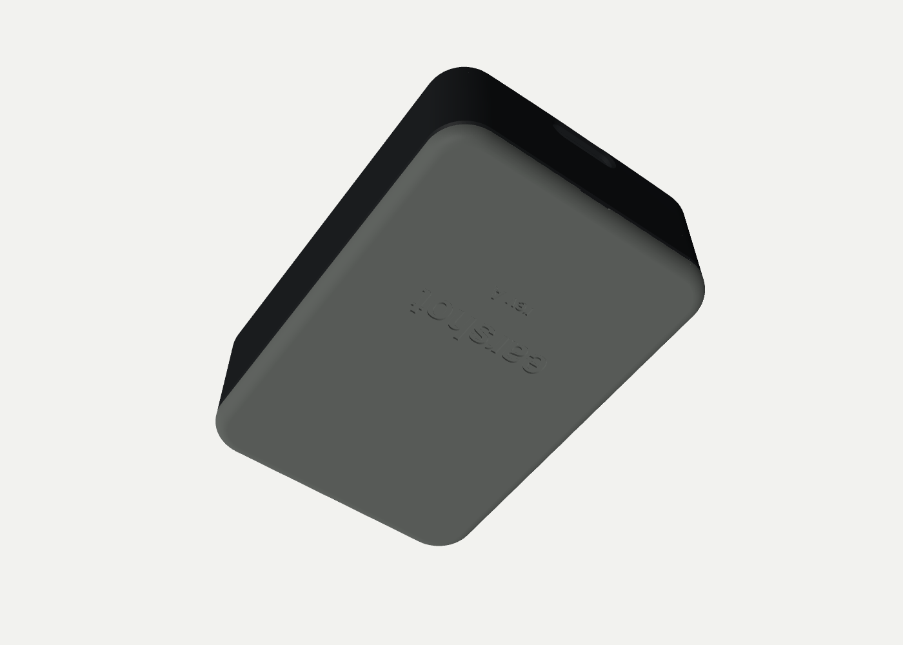
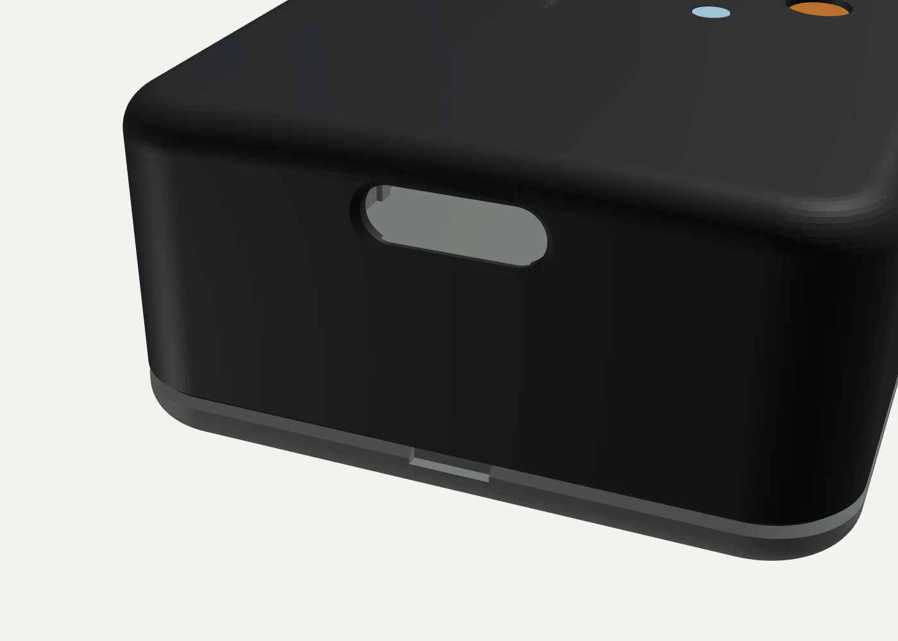
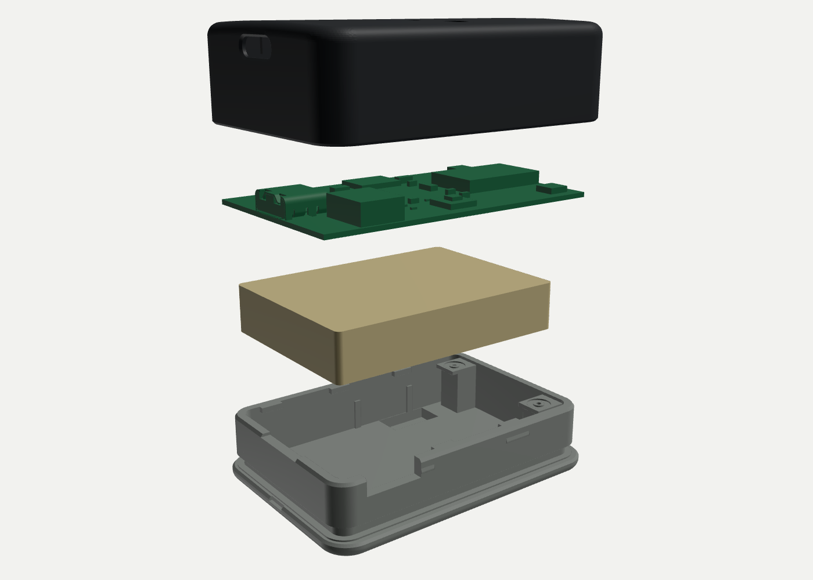

# Earshot enclosure (rev A board)

Sealed, re-openable case for the 30 × 50 mm nRF52840 board and the LP803040 cell.
Outside **36.6 × 52.6 × 17.8 mm**, about 13 g in PA12 plus the parts below. **No glue anywhere:** every
seal is a stock O-ring and every part drops in and is held by the parts around it.

| Front | Back | USB-C end |
|---|---|---|
|  |  |  |



## Files
- `earshot_case.py`: the parametric model (CadQuery). Every dimension is a named constant at the top.
- `out/earshot-shell|back|button|lightpipe.step/.stl`: print/CNC files, regenerated by the script.
- `sections.py` → `img/section-*.png`: cross-sections with the board and battery in place.
- `earshot-case.html`: the earlier concept mockup (kept for reference). It loads `board-model.js`, a
  base64 GLB of the board exported with `kicad-cli pcb export glb` (not committed).

```sh
pip install cadquery matplotlib
python3 earshot_case.py --check   # exports + interference check against the board, USB-C STEP and battery
python3 sections.py               # redraw the section images
```
`--check` should only report the two intended interferences: the front crush ribs (0.03 mm into the PCB
top face) and the battery crush ribs (0.1 mm into the nominal cell).

## How it goes together
Four printed parts: **shell** (front and walls), **back** (plug that carries the seal, battery, magnets
and mic ducts), **button** plunger and **light pipe** (print in clear resin).

1. Fit a 4 × 2 × 1 O-ring on the button and on the light pipe. Push both through their bores from the
   inside of the shell until they stop on their shoulders.
2. Stick the two ePTFE membranes (peel-and-stick, no glue) into the round recesses inside the top wall,
   over the mic ports.
3. Lay the shell face down and drop the board in, components first. The pocket locates it to 0.15 mm,
   the USB-C lines up with its opening, and the board traps the button and light pipe.
4. Plug the battery into J3. Run the wire over the right board edge through the notch beside J3, then
   back over the cell's top face in a slot in the foam pad. Put the cell's leads at its top end and
   tuck any slack beside the right mic column, not in the middle under the antenna.
5. Drop the two magnets into the back floor pockets (opposite poles out) and lay a 4 × 2 × 1 O-ring in
   the groove on top of each mic column. Put the cell in its cradle (it sits on the magnets and holds
   them in) and the loose foam pad on the cell.
6. Wipe a little silicone grease on the 48 × 1.5 O-ring, roll it into the groove on the back's ring, and
   press the back in **slowly** until the four latches click. The membranes let the trapped air bleed out.
7. To open it, put a spudger in the notch at the bottom edge of the parting line and lever.

### microSD card
The board's microSD socket (J4, hinged lid, left edge) faces the front wall with 1.9 mm to spare. The lid can't open
inside the case: to change the card, open the back, lift out the cell and then the board, flip the lid up, swap the
card, and reassemble.

## What holds each part
| Part | Located by | Held by |
|---|---|---|
| PCB | pocket walls (0.15 mm gap all round), corner reliefs for its sharp corners | 15 crush ribs on the top-face edge strips (all in part-free bands) against the back's ring top (top and bottom edges), 5 side tabs, the two mic columns and the foam pad |
| Battery | ring inner walls, 8 crush ribs | back floor below, 1.5 mm foam pad above (squeezed to 1.4 mm) |
| USB-C | board pocket | ring top is relieved under the THT legs |
| Button | Ø3.6 bore in a boss | flange under the boss (can't fall out), O-ring on the stem |
| Light pipe | Ø3.6 bore + Ø2.1 window | shoulder against the bore step outward, its foot sits on the PCB around the LED |
| Magnets | pockets in the back floor, 0.4 mm skin outside | the battery sits on top of them |
| Back | bore, O-ring | 4 ramped latch bumps in detent pockets; the O-ring friction alone holds it too |

## Sealing
The only openings are the USB-C port and the two mic ports. Everything else is closed:
- **Shell to back:** radial O-ring, stock metric **48 × 1.5 mm** (51 mm OD), NBR 70 or silicone: 20 %
  squeeze, 3.4 % stretch, 74 % groove fill. It sits close to the mouth so it only seals over the last
  ~1.2 mm of travel, which keeps the trapped-air spring small. A radial seal needs no clamping force,
  which is why there are no screws (the board has no mounting holes, and screw bosses would have made it
  ~6 mm bigger each way). `python3 earshot_case.py` prints the stretch/squeeze/fill for the current numbers.
- **Button:** O-ring 2 × 1 mm on the plunger stem (25 % squeeze), plus a 0.5 mm finger dish.
- **LED:** printed clear light pipe with the same stem and O-ring as the button. Its foot hoods the LED so
  light doesn't spill into the case, and a Ø2 tip sits flush in the front.
- **Mics:** each port is a straight 0.9 mm hole (easy to clear with a drill bit) with an acoustic ePTFE
  membrane on the inside. Inside it, a 4 × 2 × 1 O-ring in a face groove on the duct column seals it to
  the PCB around the sound hole (squeezed 20 % when the back is in).
  The path is about 9 mm long, so its quarter-wave resonance is ~9.5 kHz, above the speech band.
- **USB-C:** the opening is the plug shell (8.25 × 2.40) plus 0.2 mm all round, i.e. 8.65 × 2.85 mm, with
  a 0.35 mm chamfer. The receptacle face sits 1.35 mm behind the outside surface. The bottom wall is 0.8 mm
  there to get it that close. The TYPE-C-31-M-12 receptacle itself is not waterproof, so water can get
  through it. To fully seal this port, a later board revision would need a gasketed (IPX7) receptacle, or
  you can use a silicone dust plug.

## Bought parts
| Qty | Part | Where |
|---|---|---|
| 1 | O-ring 48 mm ID × 1.5 mm (51 mm OD), NBR 70 or silicone | Amazon "uxcell O-ring 51mm OD 48mm ID 1.5mm"; any metric O-ring seller |
| 4 | O-ring 2 mm ID × 1 mm (4 mm OD), NBR or silicone | uxcell 4 × 2 × 1 mm (button, light pipe, 2 mic columns) |
| 2 | Adhesive ePTFE vent, Ø3.5 mm OD (Ø1.5 mm open centre) | Amazon "waterproof breathable hydrophobic membrane E-PTFE adhesive 3.5mm" |
| 1 | Foam pad 30 × 42 × 1.5 mm, closed-cell EVA, cut-outs for the USB-C legs and the battery wire | cut from a craft sheet; lies loose |
| 2 | N52 magnet 10 × 5 × 2 mm | |
| — | Silicone O-ring grease | |

## Printing
Best: **MJF PA12** (JLCPCB/PCBWay 3D printing) dyed black, or SLA in a tough resin. Order the shell and the
back in contrasting colours for the two-tone look. Both have a 0.4 mm chamfer at the parting line, which
leaves a deliberate shadow line and hides small mismatches. Print the plunger in tough resin or PA12,
and the light pipe in clear resin (JLC "clear resin"/SLA), lightly sanded and clear-coated on the tip.
FDM is possible at 100 % infill with 0.2 mm layers, but the 0.8 mm USB-C wall, 0.9 mm ports and the
O-ring gland surfaces will need cleanup. Check the O-ring fit on a first print and adjust `FIT` or
`GROOVE_DEPTH` if it's too tight or loose.

## Notes and limits
- The battery sits 1.75 mm higher than SPEC.md's original layout (top end now 6.25 mm below the board's top
  edge, still clear of the antenna keep-out); small shelves on the mic columns reach over its top edge. That freed space for the O-ring below the USB-C so the port
  can be this close to the surface.
- J3 is assumed 3.5 mm tall with the plug mated; there is 0.9 mm more above it.
- The three-chip SPI NAND change only adds ≤1 mm parts beside the module. Nothing in the case sits over
  that area, so it doesn't affect the case. Re-run `--check` once that board lands.
- Tag-Connect (J2) is under the front wall: flash the bootloader before closing the case, then update over USB.
- The label on the back uses a system font; if no font is found the label is just skipped.
